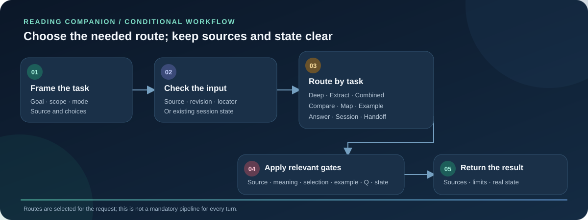

<p align="center">
  
</p>

<h1 align="center">Reading Companion</h1>

<p align="center"><strong>A source-grounded AI companion for deep reading, knowledge extraction and learning progress</strong></p>
<p align="center"><em>Vietnamese-first reading and knowledge compilation, with bilingual project documentation.</em></p>

<p align="center">
  <a href="plugin.json"></a>
  <a href="#verification"></a>
  <a href="https://github.com/Nohfinl99/Reading_Companion/actions/workflows/validate.yml"></a>
  <a href="LICENSE"></a>
  
</p>

<p align="center"><a href="README.vi.md">Đọc bằng tiếng Việt</a></p>

Reading Companion turns a selected portion of a book or document into an explanation, traceable knowledge units and a next learning step. The reader chooses the goal, scope and reading mode; the Companion preserves argument flow, locators, application conditions and evidence limits.

> **Core principle:** distinguish what the source says from what AI infers, selects or creates.

**Jump to:** [Implementation](#implementation) · [Quick start](#quick-start) · [Modes](#reading-modes) · [Routing](#routing) · [Outputs](#outputs) · [Verification](#verification) · [Docs](#documentation)

<a id="implementation"></a>
## 1. What is actually implemented

Reading Companion is a **plugin package with one skill**, not a standalone application and not a software multi-agent system. A compatible host LLM reads the skill instructions and performs the reading workflow. Protocol “roles” and “stacks” organize responsibilities; they do not create separate software agents.

| Layer | Implemented as | Responsibility | Boundary |
|---|---|---|---|
| Host runtime | Compatible LLM host + `SKILL.md` | Reads the source, follows the workflow and produces the answer | This repository does not provide the host, a book library, an MCP server or account memory |
| Controller | Master instruction `M01–M07` | Frames goal/scope, routes work, applies gates and states limits | A prose controller executed by the host LLM—not an executable orchestration service |
| Protocol stacks | Knowledge Compiler, reading protocols and stack contracts | Define source handling, units, session state, artifacts and evaluation contracts | Contracts specify behavior; they do not by themselves prove a run happened |
| Deterministic helpers | Four Python scripts | Validate plans, maps, checkpoints and session state | Structural/state checks only; they do not understand a book or grade semantic correctness |
| Repository assurance | Repository validator + pytest guard suite | Checks package structure and locks helper guard behavior | Does not measure reading quality or learning outcomes |

<a id="quick-start"></a>
## 2. 📖 Quick start

Open Reading Companion in a compatible host, provide or attach the material, then state the **goal**, **scope** and **mode**. If no mode is selected, ask the Companion to recommend one and explain why. Installation/loading and source access depend on the host.

```text
Read chapter 2 deeply, from “Problem Framing” through “Opportunity Mapping”.
Explain the argument flow, attach locators to each point and stop with a question for me to answer.
```

Or:

```text
Extract applicable ideas from the selected section. State the selection criteria and locators.
Distinguish author-specified counts from your own selection; identify any source gaps.
```

<a id="reading-modes"></a>
## 3. Choose a reading mode

| Mode | Use it when | Main output |
|---|---|---|
| `deep` | You want to understand concepts, conditions and arguments | Sourced explanation, relationships between ideas and a learning question when appropriate |
| `extract` | You want a knowledge set from a defined scope | Knowledge Units, locators, conditions, relations and selection provenance |
| `combined` | You want understanding and reusable artifacts together | Explanation and units share IDs; pending questions remain pending |

Mode identifies the task. Styles such as `standard`, `quick`, `chill` or `challenger` adjust presentation only; they do not change the mode or relax source checks.

<a id="routing"></a>
## 4. 🔄 How a request is routed

Each request takes only the route it needs—not the full workflow by default:

1. **Frame** the goal, scope, mode and available source or state.
2. **Check access and locators.** Inaccessible material and missing state are named instead of being reconstructed.
3. **Route** with the `M04` trigger matrix to the relevant Knowledge Compiler or reading-protocol stack.
4. **Apply the relevant gates.** Structured plans, maps, checkpoints and session state can be checked by the Python helpers.
5. **Present the result with its limits**, including provenance, unresolved points and any pending learner response.

<p align="center">
  
</p>

Session navigation or assessment of a pending answer can use existing state without recompiling the book. See the [system architecture](docs/architecture.en.md) for the responsibilities of each layer.

<a id="outputs"></a>
## 5. Supported tasks and artifacts

| Task | What the Companion does | Conditions and limits |
|---|---|---|
| Compare | Compares options against shared criteria, context, sources and conditions; reports differences, trade-offs and unresolved points | Does not invent scores or assume newer sources are always correct |
| Knowledge map | Represents grounded nodes and relations as an outline, table or diagram | A diagram does not establish a relation or learning order by itself |
| Apply with examples | Creates a labeled example connected to units, argument steps and preserved/changed conditions | A hypothetical example is not evidence of real-world effectiveness |
| Respond to an answer | Compares an actual learner response with its pending question and previously prepared criterion | Without a response, assessment remains pending; no answer or mastery is fabricated |
| Time-sensitive claims | Checks dynamic claims against current sources within the task's scope | Requires host/tool access; otherwise the claim is marked unchecked |
| Continue a session | Navigates, pauses/resumes, checks progress or hands off an available checkpoint | Only supplied or saved state can be restored; there is no automatic synchronization |

Artifacts are selected for the goal, not required in every session:

| Goal | Possible artifact |
|---|---|
| Inspect scope and structure | Source/read map, outline or diagram (`RA-01`) |
| Understand content and argument flow | Sourced explanation; claims, premises, evidence and conditions (`RA-02`, `RA-03`) |
| Compare options | Comparison using shared criteria and context (`RA-04`) |
| Build review material | Knowledge Units with locators/conditions and supplementary flashcards (`RA-05`, `RA-06`) |
| Apply or test transfer | A connected new example or scenario question (`RA-07`) |
| Get feedback and continue | Feedback on an actual response (`RA-08`); a handoff/checkpoint with real state (`RA-09`) |

The `RA-*` codes are technical IDs in the [artifact registry](skills/sid-reading-companion/references/reading-protocols.md#r09--output-artifacts-oa1oa4). When a contract-shaped artifact cannot be emitted, the content may be presented as Markdown/prose.

## 6. Source, state and evidence rules

- Locators and reading scope bound the claims; inaccessible source material must be identified.
- Knowledge Unit counts follow the content and selected scope, not a fixed quota. If AI selects a list, it states the criteria, origin and what was excluded or unchecked.
- New examples must connect explicitly to the relevant unit and argument; an illustrative example does not prove effectiveness.
- AI-created headings or counts must not be presented as author-defined structure.
- A question remains `WAIT_RESPONSE` until the learner answers or asks to move on. Do not fabricate responses, mastery, checkpoints or memory.

Field details and owners are in the [principle map](docs/principles.en.md) and [Stack contracts](skills/sid-reading-companion/references/stack-contracts.md).

<a id="verification"></a>
## 7. ✅ Deterministic helpers and verification

The optional helpers provide the executable part of the control flow:

| Helper | Structural responsibility | Guard cases |
|---|---|---:|
| `checkpoint.py` | Validates and exports checkpoints; checks source identity/hash, revisions, excerpts, locators and currency | CP: 81 |
| `reading_session.py` | Performs session-state operations used by checkpoints and continuation flows | RS: 60 |
| `knowledge_compiler.py` | Validates source inventories and Knowledge Units; builds routing, reference and event plans | KC: 58 |
| `ia_map.py` | Validates and represents information-architecture maps and their relations | IA: 35 |

Run the helper guard suite from the repository root:

```bash
python -m pip install pytest
python -m pytest tests/ -q
```

**Verification snapshot — 2026-10-23, Python 3.12.3, pytest 9.1.1, for the 0.3.5 release (continuity fix, KC-08 routing fix and sibling-guard fixes included):**

- **234 specified guard cases** across the four helpers, plus CLI-security and regression tests added by the fix waves.
- Full suite result: **556 passed, 0 xfailed**.
- Independent re-checks: **234/234 case IDs present**, all stage/section lists matched, mutation probes **8/8 caught** on the extended bank.
- Independent adversarial acceptance from the red-team / pen-test wave: **39/39 red-team probes blocked** — including symlink write-through, forged checkpoint fields, duplicate JSON keys, deeply nested JSON, and oversized sources (a 256 MB multi-line source validates by streaming at ~19 MB peak memory; a single line over 1 MiB is rejected cleanly).

The suite locks the current **mechanical/structural layer**. It does not establish semantic correctness, host-LLM behavior, benchmark success or learning outcomes. The `B01–B08` benchmark cases remain specifications until a case is run with actual inputs, outputs and grading evidence.

### Security hardening (from the red-team / pen-test wave)

The helpers were hardened against the adversarial probes that initially bypassed them:

- `checkpoint.validate()` now locks the field set at every level — self-declared fields such as `semantic_verified` or `mastery_claim` are rejected instead of being saved as if checked.
- All JSON entry points reject duplicate keys and oversized inputs; deeply nested JSON fails cleanly as `{ok: false}` in all three CLIs instead of crashing with a traceback.
- Output symlink checks are consistent across all three CLIs, including dangling symlinks.
- Grounding excerpts must meet a minimum size (≥ 10 characters and ≥ 2 words) in checkpoints and session evidence.
- Source files are read by streaming with a 1 MiB per-line cap; states may declare a `source_root`, and exports warn explicitly when sources are self-declared without one.
- Session support can no longer “decrease into the unknown”: moving to `unknown` from a known support level is treated as a loss and blocked. Learning-order cycles are checked regardless of the requested views, and Mermaid reserved words are rejected as map node IDs.
- Support also cannot be laundered upward: a pending question whose support is `unknown` cannot be rewritten to `none` through an intermediate save, a legacy question without context cannot be given a known-support context or an `independent` assessment, and a resolving assessment cannot record less support than the question actually had (`worked_example → hint` is rejected, not just drops to `none`). This closes the two-step continuity bypass tracked in [issue #8](https://github.com/Nohfinl99/Reading_Companion/issues/8); the previous test expectation that allowed `unknown → none` was superseded against SC04/R11.
- Two earlier defects are fixed: `timestamp()` reports its intended “needs timezone” diagnostic (was [issue #1](https://github.com/Nohfinl99/Reading_Companion/issues/1)), and the `Cannot overwrite source` guard in `export()` is reachable again (was [issue #2](https://github.com/Nohfinl99/Reading_Companion/issues/2)). Two sibling instances of the same patterns are fixed as well ([issue #5](https://github.com/Nohfinl99/Reading_Companion/issues/5)): the `checked_at` timezone diagnostic of `current_source` units in `validate()`, and the differ-from-source guard order in `initialize()`.

### Declared gaps

- The continuity guards protect transitions that go through `save()`; a state file edited directly outside the helper cannot be detected by the static validator.
- **KC-08 (resolved):** `reference_plan('transfer')` now returns `[R09, R13, R04, R06]`; `R13` (the examples & transfer owner) is no longer missing from the transfer reference plan. This closes the previously declared routing gap (decision 2026-10-23).
- Routing instructions currently have no few-shot routing examples and no global precedence/tie-break rule for overlapping triggers. The only explicit repair cap is local to `R14` validation; there is no general runtime loop budget.
- Trace/sidecar formats are specified in the contracts, but this version has no dedicated trace writer or sidecar export step.

GitHub Actions validates manifests, repository structure and documentation links, helper syntax and CLI interfaces on Python 3.10–3.12. **Note:** the pytest step is not yet part of the workflow on `main`—run the suite locally with the commands above until a maintainer adds that step. The [quality guide](docs/quality.en.md) explains the evidence limits, and the [benchmark specification](skills/sid-reading-companion/references/case-benchmark.md) defines the evidence required before a benchmark may be reported as passed.

## 8. Quick extraction example

<a id="quick-extract"></a>
The [*AI Engineering* Extract · Quick conversation](https://chatgpt.com/share/6ac9b71a-81cc-83ec-a8bf-4b2d2ae85cc8) illustrates how reading content can be connected to an application guide.

<p align="center">
  
</p>

In the example, the set of 10 principles is explicitly labeled as **selected and synthesized by AI**, not an official numbered list from the author. The application workflow and percentages in the conversation are illustrative and hypothetical—not Reading Companion results. The conversation also does not establish that the entire book was reviewed.

<a id="documentation"></a>
## 9. Documentation map

| If you need… | Read… |
|---|---|
| Architecture and workflow | [Architecture](docs/architecture.en.md) |
| Principle-to-owner traceability | [Principle map](docs/principles.en.md) |
| CI, benchmark and evidence limits | [Quality guide](docs/quality.en.md) |
| All Vietnamese/English pages | [Documentation map](docs/README.md) |
| Runtime routing, behavior and gates | [Master instruction](skills/sid-reading-companion/references/master-instruction.md) |
| Sources, units and execution plans | [Knowledge compiler](skills/sid-reading-companion/references/knowledge-compiler.md) |
| Stacks and session state | [Reading protocols](skills/sid-reading-companion/references/reading-protocols.md) |
| Schemas, provenance and question state | [Stack contracts](skills/sid-reading-companion/references/stack-contracts.md) |

```text
docs/                         Human-facing architecture, principles and quality guides (VI/EN)
skills/sid-reading-companion/ Runtime entry, canonical references and optional helpers
tests/                        Pytest guard suite for the four Python helpers
tools/                        Repository validation
assets/                       Product logo and explanatory illustrations
.github/                      CI and contribution templates
```

<a id="contributing"></a>
## 10. Contributing and license

Read the [contribution guide](CONTRIBUTING.md); changes should preserve routing, provenance, IDs, contracts and pending-question state. See the [changelog](CHANGELOG.md). The repository is distributed under the [MIT License](LICENSE).

Technical plugin ID: `sid-reading-companion` · Display name: **Reading Companion** · Version: **0.3.5**.
