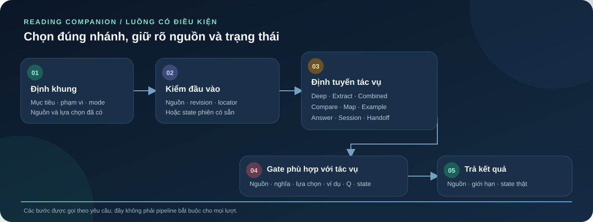
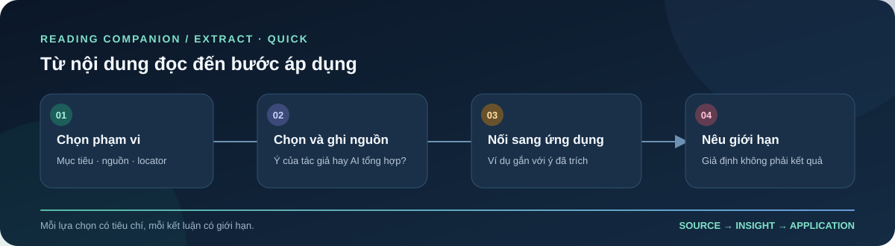

<p align="center">
  
</p>

<h1 align="center">Reading Companion</h1>

<p align="center"><strong>Trợ lý AI đọc sâu, trích xuất tri thức có nguồn và theo dõi tiến trình học tập</strong></p>
<p align="center"><em>A Vietnamese-first, source-grounded reading and knowledge-compilation plugin.</em></p>

<p align="center">
  <a href="plugin.json"></a>
  <a href="#verification"></a>
  <a href="https://github.com/Nohfinl99/Reading_Companion/actions/workflows/validate.yml"></a>
  <a href="LICENSE"></a>
  
</p>

<p align="center"><a href="README.md">Read in English</a></p>

Reading Companion biến một phạm vi sách hoặc tài liệu thành lời giải thích, đơn vị tri thức và bước học tiếp theo có thể truy ngược về nguồn. Người đọc chọn mục tiêu, phạm vi và cách đọc; Companion giữ mạch lập luận, locator, điều kiện áp dụng và giới hạn bằng chứng.

> **Nguyên tắc cốt lõi:** phân biệt điều tài liệu nói với điều AI suy luận, chọn hoặc biên soạn.

**Đi nhanh:** [Hiện trạng triển khai](#implementation) · [Bắt đầu](#quick-start) · [Modes](#reading-modes) · [Định tuyến](#routing) · [Đầu ra](#outputs) · [Kiểm chứng](#verification) · [Tài liệu](#documentation)

<a id="implementation"></a>
## 1. Hệ thống đã triển khai thực tế

Reading Companion là **một package plugin chứa một skill**, không phải ứng dụng chạy độc lập và cũng không phải hệ thống multi-agent bằng phần mềm. Host LLM tương thích đọc chỉ dẫn của skill và thực hiện workflow đọc. Các “role” và “stack” trong giao thức dùng để phân chia trách nhiệm; chúng không tạo ra các agent phần mềm độc lập.

| Tầng | Hình thức triển khai | Trách nhiệm | Giới hạn |
|---|---|---|---|
| Host runtime | Host LLM tương thích + `SKILL.md` | Đọc nguồn, tuân theo workflow và tạo câu trả lời | Repository không cung cấp host, thư viện sách, MCP server riêng hay bộ nhớ tài khoản |
| Controller | Master instruction `M01–M07` | Định khung goal/scope, định tuyến, áp dụng gate và nêu giới hạn | Là controller bằng văn bản do host LLM thực thi—không phải dịch vụ điều phối chạy bằng code |
| Protocol stacks | Knowledge Compiler, reading protocols và stack contracts | Quy định cách xử lý nguồn, unit, trạng thái phiên, artifact và tiêu chí đánh giá | Contract mô tả hành vi; tự nó không chứng minh một lượt chạy đã xảy ra |
| Helper xác định | Bốn script Python | Kiểm tra execution plan, map, checkpoint và trạng thái phiên | Chỉ kiểm tra cấu trúc/state; không đọc hiểu sách hay chấm đúng sai về ngữ nghĩa |
| Đảm bảo chất lượng repo | Repository validator + bộ test guard bằng pytest | Kiểm tra cấu trúc package và khóa hành vi guard của helper | Không đo chất lượng đọc hiểu hay kết quả học tập |

<a id="quick-start"></a>
## 2. 📖 Bắt đầu nhanh

Mở Reading Companion trong host tương thích, cung cấp hoặc đính kèm tài liệu, rồi nêu **mục tiêu**, **phạm vi** và **mode**. Nếu chưa chọn mode, hãy yêu cầu Companion đề xuất và giải thích lý do. Cách cài/nạp và quyền truy cập nguồn tùy thuộc vào host.

```text
Đọc sâu chương 2, từ mục “Problem Framing” đến hết “Opportunity Mapping”.
Giải thích mạch lập luận, gắn locator cho từng ý và dừng lại bằng một câu hỏi để tôi trả lời.
```

Hoặc:

```text
Trích xuất các ý có thể áp dụng trong phần đã chọn. Nêu tiêu chí lựa chọn và locator.
Phân biệt số lượng tác giả quy định với phần AI tự chọn; nêu rõ phần nguồn còn thiếu.
```

<a id="reading-modes"></a>
## 3. Chọn chế độ đọc

| Mode | Dùng khi | Đầu ra trọng tâm |
|---|---|---|
| `deep` | Muốn hiểu khái niệm, điều kiện và lập luận | Giải thích có nguồn, quan hệ giữa các ý và câu hỏi học tập khi phù hợp |
| `extract` | Muốn tạo kho tri thức trong một phạm vi | Knowledge Units, locator, điều kiện, quan hệ và provenance của lựa chọn |
| `combined` | Muốn vừa hiểu vừa tạo artifact để xem lại | Explanation và units dùng chung ID; câu hỏi đang chờ được giữ nguyên |

Mode xác định loại tác vụ. Style như `standard`, `quick`, `chill` hoặc `challenger` chỉ điều chỉnh cách trình bày, không thay mode hay bỏ điều kiện kiểm nguồn.

<a id="routing"></a>
## 4. 🔄 Cách một yêu cầu được định tuyến

Mỗi yêu cầu chỉ đi theo nhánh cần thiết—không mặc định chạy toàn bộ workflow:

1. **Định khung** mục tiêu, phạm vi, mode, nguồn hoặc state hiện có.
2. **Kiểm tra quyền truy cập và locator.** Nguồn không truy cập được và state còn thiếu phải được nêu rõ, không tự dựng lại.
3. **Định tuyến** bằng ma trận trigger `M04` tới Knowledge Compiler hoặc reading-protocol stack phù hợp.
4. **Áp dụng gate liên quan.** Execution plan, map, checkpoint và trạng thái phiên có cấu trúc có thể được kiểm bằng helper Python.
5. **Trình bày kết quả kèm giới hạn**, gồm provenance, điểm chưa giải quyết và câu hỏi đang chờ người học trả lời nếu có.

<p align="center">
  
</p>

Điều hướng phiên hoặc đánh giá câu trả lời đang chờ có thể dùng state hiện có mà không biên dịch lại sách. Xem [kiến trúc hệ thống](docs/architecture.vi.md) để biết trách nhiệm của từng tầng.

<a id="outputs"></a>
## 5. Tác vụ và artifact được hỗ trợ

| Tác vụ | Companion hỗ trợ | Điều kiện và giới hạn |
|---|---|---|
| So sánh | Đối chiếu lựa chọn theo cùng tiêu chí, bối cảnh, nguồn và điều kiện; nêu khác biệt, đánh đổi và điểm chưa giải quyết | Không tự chấm điểm hoặc coi nguồn mới hơn luôn đúng |
| Bản đồ tri thức | Biểu diễn node và quan hệ có căn cứ thành outline, bảng hoặc sơ đồ | Sơ đồ không tự chứng minh quan hệ hoặc thứ tự học |
| Ví dụ áp dụng | Tạo ví dụ có nhãn, nối với unit, bước lập luận và điều kiện được giữ/thay đổi | Ví dụ giả định không phải bằng chứng hiệu quả thực tế |
| Phản hồi câu trả lời | Đối chiếu câu trả lời thật với câu hỏi đang chờ và tiêu chí đã chuẩn bị | Chưa có response thì giữ trạng thái chưa đánh giá; không tự tạo câu trả lời hoặc mastery |
| Claim nhạy theo thời gian | Đối chiếu claim động với nguồn hiện tại trong phạm vi cần kiểm | Cần host/tool truy cập nguồn; nếu không có, nêu rõ chưa kiểm hiện hành |
| Tiếp tục phiên | Điều hướng, tạm dừng/tiếp tục, xem tiến độ hoặc bàn giao checkpoint có sẵn | Chỉ khôi phục dữ liệu thực được cung cấp/lưu; không đồng bộ tự động |

Artifact được chọn theo mục tiêu, không phải danh sách bắt buộc trong mọi phiên:

| Mục tiêu | Artifact có thể dùng |
|---|---|
| Xem phạm vi và cấu trúc | Source/read map, outline hoặc sơ đồ (`RA-01`) |
| Hiểu nội dung và mạch lập luận | Giải thích có nguồn; claim, premise, evidence và điều kiện (`RA-02`, `RA-03`) |
| Đối chiếu lựa chọn | Bảng so sánh cùng tiêu chí và bối cảnh (`RA-04`) |
| Tạo tài liệu ôn tập | Knowledge Units có locator/điều kiện và flashcards bổ sung (`RA-05`, `RA-06`) |
| Áp dụng hoặc kiểm tra transfer | Ví dụ mới có cầu nối hoặc câu hỏi tình huống (`RA-07`) |
| Phản hồi và tiếp tục | Feedback cho response thật (`RA-08`); bản handoff/checkpoint có state thực (`RA-09`) |

Các mã `RA-*` là technical IDs trong [artifact registry](skills/sid-reading-companion/references/reading-protocols.md#r09--output-artifacts-oa1oa4). Khi không thể xuất artifact đúng contract, nội dung có thể được trình bày bằng Markdown/văn bản thường.

## 6. Quy tắc về nguồn, state và bằng chứng

- Locator và phạm vi đọc giới hạn điều có thể kết luận; nguồn chưa truy cập được phải được nêu rõ.
- Số Knowledge Units phát sinh từ nội dung/phạm vi, không theo quota cố định. Nếu AI chọn danh sách, cần nêu tiêu chí, nguồn gốc và phần không chọn/chưa kiểm.
- Ví dụ mới phải nối rõ với unit và mạch lập luận liên quan; ví dụ minh họa không tự chứng minh hiệu quả.
- Tiêu đề hoặc con số do AI tạo không được trình bày như cấu trúc tác giả quy định.
- Câu hỏi đã đặt chờ câu trả lời thật (`WAIT_RESPONSE`) hoặc lệnh chuyển bước. Không tạo response, mastery, checkpoint hay memory giả.

Chi tiết field và chủ sở hữu nằm trong [bản đồ nguyên lý](docs/principles.vi.md) và [Stack contracts](skills/sid-reading-companion/references/stack-contracts.md).

<a id="verification"></a>
## 7. ✅ Helper xác định và kiểm chứng

Các helper tùy chọn tạo thành phần có thể thực thi bằng code của luồng kiểm soát:

| Helper | Trách nhiệm cấu trúc | Số case guard |
|---|---|---:|
| `checkpoint.py` | Kiểm tra và xuất checkpoint; kiểm identity/hash của nguồn, revision, excerpt, locator và tính hiện hành | CP: 81 |
| `reading_session.py` | Thực hiện các thao tác trạng thái phiên dùng cho checkpoint và luồng tiếp tục phiên | RS: 60 |
| `knowledge_compiler.py` | Kiểm tra source inventory và Knowledge Units; tạo routing plan, reference plan và event plan | KC: 58 |
| `ia_map.py` | Kiểm tra và biểu diễn information-architecture map cùng các quan hệ của nó | IA: 35 |

Chạy bộ test guard của helper từ thư mục gốc của repository:

```bash
python -m pip install pytest
python -m pytest tests/ -q
```

**Ảnh chụp kiểm chứng — 23/10/2026, Python 3.12.3, pytest 9.1.1, sau đợt vá continuity:**

- **234 case guard đã đặc tả** cho bốn helper, cộng thêm các test an ninh CLI và test hồi quy của các đợt vá.
- Kết quả toàn bộ suite: **556 passed, 0 xfailed**.
- Kiểm tra độc lập: **234/234 ID case đều có mặt**, toàn bộ danh sách stage/section khớp, mutation probe **8/8 bị bắt** trên ngân hàng mở rộng.
- Nghiệm thu đối kháng độc lập: **39/39 probe red team bị chặn** — gồm viết xuyên symlink, trường checkpoint tự phong, duplicate JSON key, JSON lồng sâu và nguồn quá khổ (nguồn 256 MB nhiều dòng được validate bằng đọc luồng với peak bộ nhớ ~19 MB; một dòng đơn vượt 1 MiB bị từ chối sạch).

Bộ test khóa **lớp cơ học/cấu trúc hiện tại**. Nó không chứng minh đúng sai về ngữ nghĩa, hành vi của host LLM, benchmark thành công hay kết quả học tập. Các case benchmark `B01–B08` vẫn là đặc tả cho tới khi từng case được chạy với input, output và bằng chứng chấm thực tế.

### Lớp hardening an ninh (từ vòng red team / pen test)

Các helper đã được gia cố đúng vào những đường mà probe đối kháng từng lọt qua:

- `checkpoint.validate()` khóa tập trường ở mọi cấp — trường tự khai như `semantic_verified` hay `mastery_claim` bị từ chối thay vì được save như thể đã kiểm.
- Mọi điểm nạp JSON đều chặn key trùng và input quá khổ; JSON lồng sâu trả `{ok: false}` sạch ở cả 3 CLI thay vì sập traceback.
- Kiểm tra symlink ở output nhất quán trên cả 3 CLI, kể cả dangling symlink.
- Excerpt dùng làm căn cứ phải đạt ngưỡng tối thiểu (≥ 10 ký tự và ≥ 2 từ) ở cả checkpoint và evidence của phiên.
- File nguồn được đọc theo luồng với giới hạn 1 MiB mỗi dòng; state có thể khai `source_root`, và export gắn cảnh báo tường minh khi nguồn là tự khai mà chưa gắn gốc.
- Support của phiên không còn “giảm vào unknown”: chuyển về `unknown` từ mức đã biết bị coi là mất thông tin và bị chặn. Chu trình learning_order được kiểm bất kể views yêu cầu, và từ khóa dành riêng của Mermaid bị cấm làm ID node của map.
- Support cũng không còn bị “rửa” lên trên: một câu hỏi đang chờ có support `unknown` không thể bị ghi lại thành `none` qua một lần save trung gian, một câu hỏi legacy không có context không thể bị gắn context có support đã biết hoặc một assessment `independent`, và assessment khi resolve không được ghi support thấp hơn support thật của câu hỏi (`worked_example → hint` bị từ chối, không chỉ các lần hạ xuống `none`). Thay đổi này đóng đường vòng continuity hai bước được theo dõi ở [issue #8](https://github.com/Nohfinl99/Reading_Companion/issues/8); kỳ vọng test trước đây cho phép `unknown → none` đã bị supersede theo SC04/R11.
- Hai lỗi trước đây đã sửa: `timestamp()` trả đúng thông điệp chẩn đoán “needs timezone” (trước là [issue #1](https://github.com/Nohfinl99/Reading_Companion/issues/1)), và guard `Cannot overwrite source` trong `export()` đã chạm tới được trở lại (trước là [issue #2](https://github.com/Nohfinl99/Reading_Companion/issues/2)). Hai instance anh em cùng pattern cũng đã được sửa ([issue #5](https://github.com/Nohfinl99/Reading_Companion/issues/5)): chẩn đoán timezone của `checked_at` cho unit `current_source` trong `validate()`, và thứ tự guard differ-from-source trong `initialize()`.

### Khoảng trống đã khai báo

- Các guard continuity bảo vệ những chuyển đổi đi qua `save()`; một file state bị sửa trực tiếp ngoài helper thì validator tĩnh không phát hiện được.
- **KC-08 (đã giải quyết):** `reference_plan('transfer')` nay trả `[R09, R13, R04, R06]`; `R13` (chủ sở hữu ví dụ và transfer) không còn thiếu trong kế hoạch truy hồi của transfer. Khoảng trống định tuyến đã khai trước đây được đóng (quyết định 2026-10-23).
- Chỉ dẫn định tuyến hiện chưa có ví dụ few-shot cho routing và chưa có luật ưu tiên/phân xử chung khi nhiều trigger chồng nhau. Giới hạn sửa lỗi tường minh duy nhất hiện nằm cục bộ trong validation `R14`; chưa có ngân sách vòng lặp runtime dùng chung.
- Định dạng trace/sidecar đã được đặc tả trong contract, nhưng phiên bản này chưa có bước ghi trace hoặc xuất sidecar chuyên biệt.

GitHub Actions kiểm tra manifest, cấu trúc repository và liên kết tài liệu, cú pháp helper và giao diện CLI trên Python 3.10–3.12. **Lưu ý:** bước chạy pytest chưa nằm trong workflow trên `main`—hãy chạy bộ test tại chỗ bằng các lệnh ở trên cho tới khi maintainer bổ sung bước đó. [Hướng dẫn chất lượng](docs/quality.vi.md) giải thích giới hạn bằng chứng, còn [benchmark specification](skills/sid-reading-companion/references/case-benchmark.md) quy định bằng chứng cần có trước khi một benchmark được báo là đạt.

## 8. Ví dụ trích xuất nhanh

<a id="quick-extract"></a>
Cuộc trò chuyện mẫu về [*AI Engineering* — Extract · Quick](https://chatgpt.com/share/6ac9b71a-81cc-83ec-a8bf-4b2d2ae85cc8) cho thấy cách nối nội dung đọc với hướng dẫn áp dụng.

<p align="center">
  
</p>

Trong ví dụ, nhóm 10 nguyên lý được ghi là **do AI chọn và tổng hợp**, không phải danh sách đánh số chính thức của tác giả. Quy trình ứng dụng và các tỷ lệ trong cuộc trò chuyện chỉ là minh họa giả định—không phải kết quả chạy Reading Companion. Cuộc trò chuyện cũng không xác nhận đã kiểm tra toàn bộ cuốn sách.

<a id="documentation"></a>
## 9. Bản đồ tài liệu

| Bạn cần… | Tài liệu |
|---|---|
| Đọc kiến trúc và workflow | [Architecture](docs/architecture.vi.md) |
| Truy nguyên nguyên lý tới file sở hữu | [Principle map](docs/principles.vi.md) |
| Hiểu CI, benchmark và giới hạn bằng chứng | [Quality guide](docs/quality.vi.md) |
| Tìm các bản VI/EN | [Documentation map](docs/README.md) |
| Định tuyến, hành vi và gate runtime | [Master instruction](skills/sid-reading-companion/references/master-instruction.md) |
| Source, units và execution plan | [Knowledge compiler](skills/sid-reading-companion/references/knowledge-compiler.md) |
| Stack và trạng thái phiên | [Reading protocols](skills/sid-reading-companion/references/reading-protocols.md) |
| Schema, provenance và question state | [Stack contracts](skills/sid-reading-companion/references/stack-contracts.md) |

```text
docs/                         Human-facing architecture, principles and quality guides (VI/EN)
skills/sid-reading-companion/ Runtime entry, canonical references and optional helpers
tests/                        Pytest guard suite for the four Python helpers
tools/                        Repository validation
assets/                       Product logo and explanatory illustrations
.github/                      CI and contribution templates
```

<a id="contributing"></a>
## 10. Đóng góp và giấy phép

Đọc [hướng dẫn đóng góp](CONTRIBUTING.md); thay đổi cần giữ định tuyến, provenance, IDs, contracts và trạng thái câu hỏi. Xem [CHANGELOG](CHANGELOG.md). Repository phát hành theo [MIT License](LICENSE).

Technical plugin ID: `sid-reading-companion` · Display name: **Reading Companion** · Version: **0.3.3**.
